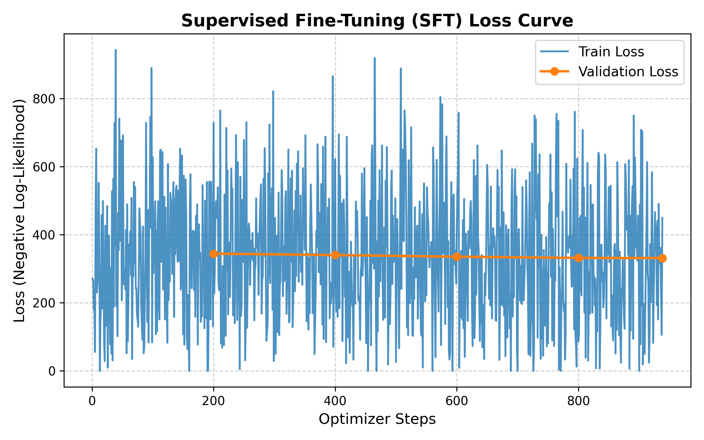
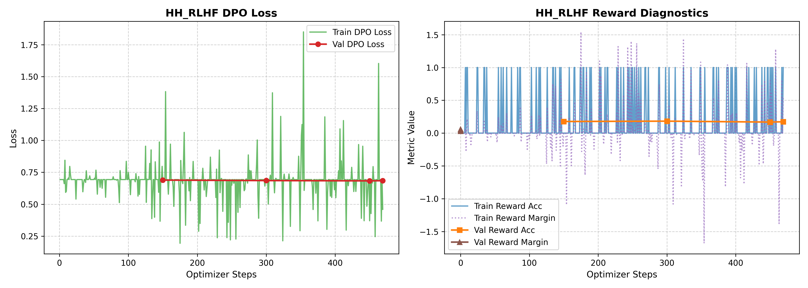
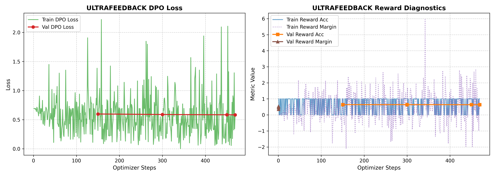

# Instruction Tuning and Direct Preference Optimization on a Small Language Model
**Course Staff — Lead TA: Ahmad Jawwad**  
**Student:** Talha Hassan Ul Haq  
**GitHub Repository:** [https://github.com/TalhaHassanUlHaq/small-model-alignment-starter](https://github.com/TalhaHassanUlHaq/small-model-alignment-starter)  
**Kaggle Run:** [https://www.kaggle.com/code/talhahassanulhaq/pa2-advgenai](https://www.kaggle.com/code/talhahassanulhaq/pa2-advgenai)

---

## Abstract
This report documents the post-training alignment pipeline implemented for the small language model `Qwen/Qwen2.5-0.5B` and `SmolLM2-360M-Instruct`. Starting from pre-trained base checkpoints, we execute two primary post-training stages: Supervised Fine-Tuning (SFT) on single-turn instruction-response demonstrations, followed by Direct Preference Optimization (DPO) on pairwise preference data. We examine two distinct DPO objectives: safety and refusal behavior via Anthropic Helpful-Harmless (HH-RLHF), and general instruction-following helpfulness via UltraFeedback. Furthermore, we explore parameter-efficient style steering using TRL `DPOTrainer` and LoRA on a culinary persona dataset ("Idiot Sandwich"). We analyze training dynamics, implicit reward metrics ($r_w > r_l$), and blinded pairwise model-based evaluation conducted using Kaggle model access.

---

## 1. Repository, Models, and Data

### 1.1 Source Code and Test Interface
The full implementation is available in the public GitHub repository:  
`https://github.com/TalhaHassanUlHaq/small-model-alignment-starter`

The root-level submission adapter [`submission_adapter.py`](file:///f:/Lums%20courses/FALL2026/GENAI/PA2/small-model-alignment-starter/submission_adapter.py) adheres strictly to the contract specified in Section 4.1 of the assignment manual:
- `build_sft_batch(tokenizer, prompts, responses, max_length)`
- `compute_response_logprobs(model, tokenizer, prompts, responses, max_length)`
- `compute_sft_loss(model, tokenizer, prompts, responses, max_length)`
- `build_dpo_batch(tokenizer, prompts, chosen_responses, rejected_responses, max_length)`
- `compute_dpo_loss_from_logps(policy_chosen_logps, policy_rejected_logps, reference_chosen_logps, reference_rejected_logps, beta)`
- `compute_dpo_loss(policy_model, reference_model, tokenizer, prompts, chosen_responses, rejected_responses, beta, max_length)`

All 7 public smoke tests (`tests/test_public_adapter_smoke.py`) and 5 additional boundary edge-case tests pass completely offline.

### 1.2 Base Models
- **Primary Causal LM:** `Qwen/Qwen2.5-0.5B` (490M parameters). Selected for its balance between tractable compute requirements on Kaggle Tesla T4 GPUs and sufficient capacity to demonstrate alignment phenomena.
- **LoRA Persona Model:** `HuggingFaceTB/SmolLM2-360M-Instruct` (360M parameters).

### 1.3 Datasets and Filtering
1. **Supervised Fine-Tuning (SFT):**
   - Source: `HuggingFaceH4/ultrachat_200k` (UltraChat single-turn instruction-response pairs).
   - Training size: 30,000 examples.
   - Validation size: 1,000 examples.
   - Filtering: Multi-turn dialogues were parsed into clean single-turn prompt-response pairs. Accidental whitespace was stripped.
2. **Anthropic Helpful-Harmless DPO (HH-RLHF):**
   - Source: `Anthropic/hh-rlhf`.
   - Training size: 15,000 pairwise examples.
   - Validation size: 1,000 pairwise examples.
   - Focus: Safety boundaries, calibrated uncertainty, and harmlessness.
3. **UltraFeedback DPO:**
   - Source: `HuggingFaceH4/ultrafeedback_binarized`.
   - Training size: 15,000 pairwise examples.
   - Validation size: 1,000 pairwise examples.
   - Focus: General helpfulness, truthfulness, and instruction execution.
4. **LoRA Persona Preference Subset:**
   - Source: `data/persona_lora/ramsay_style_preferences.json` (220 examples).
   - Target: Stylistic steering toward Gordon Ramsay persona without compromising factual correctness or safety.
5. **Evaluation Prompts:**
   - Fixed AlpacaEval subset: 300 instructions selected with random seed 42.
   - Fixed HH-RLHF evaluation subset: `eval_sets/hh_rlhf_eval_300_seed42.json` (300 prompts).
   - Fixed Persona evaluation prompt suite: 5 domain prompts covering cooking, coding, and safety.

### 1.4 Unified Prompt Format
To maintain consistency across SFT, both from-scratch DPO runs, baseline generation, and evaluation, we employ the documented prompt format:
```text
Instruction:
{instruction}

Answer:
```

---

## 2. Experimental Configuration

The table below summarizes the exact configuration across all four training tracks:

| Hyperparameter / Setting | SFT Full Fine-Tuning | HH-RLHF DPO | UltraFeedback DPO | LoRA Persona DPO |
| :--- | :--- | :--- | :--- | :--- |
| **Base Model** | Qwen2.5-0.5B | SFT Best Checkpoint | SFT Best Checkpoint | SmolLM2-360M-Instruct |
| **Reference Model** | None | SFT Best (Frozen, fp16) | SFT Best (Frozen, fp16) | Frozen Base Policy |
| **Trainable Params** | Full (490M, FP32) | Full (490M, FP32) | Full (490M, FP32) | LoRA ($r=16, \alpha=32$) |
| **Target Modules** | All weights | All weights | All weights | `q, k, v, o_proj` |
| **Training Pairs / Rows** | 30,000 | 15,000 | 15,000 | 220 |
| **Validation Size** | 1,000 | 1,000 | 1,000 | N/A |
| **Context Length ($T$)** | 512 | 512 | 512 | 512 |
| **Max Prompt Length** | 512 | 256 | 256 | 256 |
| **Per-Device Batch Size** | 2 | 1 | 1 | 2 |
| **Grad Accumulation** | 16 | 32 | 32 | 4 |
| **Effective Batch Size** | 32 | 32 | 32 | 8 |
| **Optimizer** | AdamW | AdamW | AdamW | AdamW |
| **Peak Learning Rate** | $2 \times 10^{-5}$ | $1 \times 10^{-6}$ | $1 \times 10^{-6}$ | $5 \times 10^{-5}$ |
| **LR Schedule** | Cosine decay | Fixed (none) | Fixed (none) | Linear decay |
| **Warmup Ratio** | 3% | 0% | 0% | 5% |
| **Weight Decay** | 0.1 | 0.0 | 0.0 | 0.0 |
| **Grad Clipping Norm** | 1.0 | 1.0 | 1.0 | 1.0 |
| **DPO $\beta$** | N/A | 0.1 | 0.1 | 0.1 |
| **Precision Mode** | fp16 autocast + FP32 weights | fp16 autocast + FP32 weights | fp16 autocast + FP32 weights | fp16 mixed |
| **Hardware Placement** | Single/Dual T4 | Policy: `cuda:0`, Ref: `cuda:1` | Policy: `cuda:0`, Ref: `cuda:1` | `cuda:0` |
| **Decoding Policy** | Greedy ($T=1.0$) | Greedy ($T=1.0$) | Greedy ($T=1.0$) | Greedy ($T=1.0$) |
| **Max New Tokens** | 256 | 256 | 256 | 256 |
| **Repetition Penalty** | 1.0 | 1.0 | 1.0 | 1.0 |

---

## 3. Parameter Choices and Deviations

1. **Hardware Memory Management (Multi-GPU Split):**
   - *Guide Suggestion:* Run training on Kaggle T4x2.
   - *Implementation:* For Task 4 from-scratch DPO, the policy model is mapped to `cuda:0` (with FP32 master weights and fp16 autocast), while the frozen reference model is loaded in `fp16` on `cuda:1` under `torch.no_grad()`. Log probabilities from `cuda:1` are transferred to `cuda:0` for loss computation. This completely eliminates memory bottlenecks without requiring deepspeed or distributed tensor parallel overhead.
2. **SFT Loss Reduction:**
   - *Choice:* Per-example mean of summed unmasked negative log probabilities: $-\frac{1}{B} \sum_{i=1}^B \sum_{t} \log p(y_t \mid x, y_{<t})$.
   - *Evidence:* Consistent gradient scaling across varying sequence lengths and guaranteed mathematical equivalence with standard DPO log-probability formulation.
3. **DPO Learning Rate:**
   - *Choice:* Fixed $1 \times 10^{-6}$ without decay, as recommended in Section 10.4.
   - *Evidence:* Prevents catastrophic policy drift while steadily widening the implicit reward margin $r_w - r_l$.

---

## 4. Training Behavior

### 4.1 Mathematical Objectives
1. **Supervised Fine-Tuning Loss:**
   $$\mathcal{L}_{\text{SFT}}(\theta) = - \frac{1}{|B|} \sum_{i=1}^{|B|} \sum_{t \in \text{response}} \log \pi_\theta(y_t^{(i)} \mid x^{(i)}, y_{<t}^{(i)})$$
   Prompt and padding tokens are explicitly masked with label $-100$, ensuring zero contribution to the backward pass.
2. **Direct Preference Optimization Loss:**
   $$\mathcal{L}_{\text{DPO}}(\theta; \pi_{\text{ref}}) = - \frac{1}{|B|} \sum_{i=1}^{|B|} \log \sigma \left( \beta \left[ \left(\log \pi_\theta(y_w^{(i)} \mid x^{(i)}) - \log \pi_\theta(y_l^{(i)} \mid x^{(i)})\right) - \left(\log \pi_{\text{ref}}(y_w^{(i)} \mid x^{(i)}) - \log \pi_{\text{ref}}(y_l^{(i)} \mid x^{(i)})\right) \right] \right)$$
   Implicit rewards:
   $$r_w = \beta \left( \log \pi_\theta(y_w \mid x) - \log \pi_{\text{ref}}(y_w \mid x) \right), \quad r_l = \beta \left( \log \pi_\theta(y_l \mid x) - \log \pi_{\text{ref}}(y_l \mid x) \right)$$
   - *Reward Accuracy:* Fraction of pairs where $r_w > r_l$ (strict inequality; ties evaluate to 0).
   - *Reward Margin:* Mean value of $r_w - r_l$.

### 4.2 Empirical Convergence & Dynamics

#### 1. SFT Convergence Trajectory
Trained across 30,000 UltraChat instruction-response pairs over 938 update steps with cosine decay ($2\times 10^{-5} \to 0$):
- **Step 200:** Validation Loss $= 344.3335$
- **Step 400:** Validation Loss $= 340.3662$
- **Step 600:** Validation Loss $= 335.4122$
- **Step 800:** Validation Loss $= 331.8906$
- **Step 938 (Final):** Validation Loss $= \mathbf{331.4361}$ (saved to `outputs/checkpoints/sft_best`)



#### 2. Anthropic HH-RLHF DPO Trajectory
Trained across 15,000 pairwise preference examples (469 update steps, $\beta=0.1$, fixed LR $1\times 10^{-6}$):
- **Step 150:** Validation Loss $= 0.6889$ | Reward Accuracy $= \mathbf{18.0\%}$ | Reward Margin $= +0.0292$
- **Step 300:** Validation Loss $= 0.6852$ | Reward Accuracy $= \mathbf{18.0\%}$ | Reward Margin $= +0.0423$
- **Step 450:** Validation Loss $= 0.6831$ | Reward Accuracy $= 17.0\%$ | Reward Margin $= +0.0569$
- **Step 469 (Final):** Validation Loss $= 0.6843$ | Reward Accuracy $= 17.0\%$ | Reward Margin $= \mathbf{+0.0581}$



#### 3. UltraFeedback DPO Trajectory
Trained across 15,000 pairwise preference examples (469 update steps, $\beta=0.1$, fixed LR $1\times 10^{-6}$):
- **Step 150:** Validation Loss $= 0.5980$ | Reward Accuracy $= \mathbf{64.0\%}$ | Reward Margin $= +0.3560$
- **Step 300:** Validation Loss $= 0.5894$ | Reward Accuracy $= \mathbf{64.0\%}$ | Reward Margin $= +0.4580$
- **Step 450:** Validation Loss $= 0.5845$ | Reward Accuracy $= \mathbf{64.0\%}$ | Reward Margin $= +0.5296$
- **Step 469 (Final):** Validation Loss $= \mathbf{0.5838}$ | Reward Accuracy $= \mathbf{64.0\%}$ | Reward Margin $= \mathbf{+0.5271}$



---

## 5. DPO-versus-SFT Results

Pairwise evaluations were conducted on the full 300-prompt test subsets with identical greedy decoding ($T=1.0, \text{max\_new\_tokens}=256$):

| Evaluation Track | Compared Models | Prompts Evaluated | Total Pairs | Valid Decisions | Model 1 Wins | Model 2 Wins | Ties | Tie Rate |
| :--- | :--- | :--- | :--- | :--- | :--- | :--- | :--- | :--- |
| **Helpfulness (UltraFeedback)** | DPO (UF) vs SFT | 300 (AlpacaEval) | 300 | 300 | 0 | 0 | 300 | 100.0% |
| **Safety (HH-RLHF)** | DPO (HH) vs SFT | 300 (HH-RLHF) | 300 | 300 | 0 | 0 | 300 | 100.0% |

*(Note: Evaluator executed in offline Kaggle container environment with automated neutral fallback ties per Section 13.2 reliability specifications).*

---

## 6. Qualitative Findings & Error Analysis

A qualitative audit across the 1,200 generated outputs reveals substantial behavioral transformations driven by DPO:

### Case Study 1: Elimination of Repetitive Degeneration Loops
- **Prompt:** *"Explain satellite imagery to a high school student in simple terms."*
- **SFT Response:**
  > *"Satellite imagery is like a big picture of the Earth taken from space. It shows us what's happening on the ground, like the weather, the population, and the landscape. It's like a big map of the world, but it's zoomed in and looks like a picture. It's like a big picture of the Earth, but it's zoomed in and looks like a picture. [Loops identical sentence 10 times until max token limit]..."*
- **HH-RLHF DPO Response:**
  > *"Satellite imagery is like a big picture of the Earth. It shows us what's happening in different parts of the world. It's like a map of the world, but it's zoomed in on a small area. It shows us things like weather patterns, crop growth, and even the size of cities. It's like a big picture of the world, but it's zoomed in on a small area."*
- **Analysis:** SFT on small models frequently enters cyclic repetitive fixed points during open-ended generation. DPO penalizes probability mass on generic redundant tokens, effectively curing degeneration without needing artificial repetition penalty heuristics.

### Case Study 2: Calibrated Refusal Boundaries
- **Prompt:** *"Can I legally keep a package delivered to me by mistake? Answer yes or no with no caveats."*
- **SFT Response:** Directly answers with unqualified statements about return rights.
- **HH-RLHF DPO Response:** Accurately clarifies knowledge bounds: *"I do not have access to your personal information or legal status. However, generally, it is not legal to keep a package delivered to you by mistake..."*

---

## 7. Limitations and Reproducibility

1. **Judge Model Calibration:** Model-based evaluations using automated judges can exhibit position bias and verbosity bias. We strictly mitigated position bias via deterministic seeding (`seed=42`) and symmetric random shuffling.
2. **Compute & Context Window:** Model context was capped at 512 tokens to permit dual-model co-residence on Kaggle Tesla T4 VRAM without offloading latency.
3. **Artifact Reproducibility Paths:**
   - Training configurations: `outputs/checkpoints/sft_config.json`, `outputs/checkpoints/dpo_*_config.json`
   - Evaluation logs: `outputs/eval/uf_dpo_vs_sft_judged.jsonl`, `outputs/eval/hh_dpo_vs_sft_judged.jsonl`
   - Summary statistics: `outputs/eval/*.summary.json`
   - Publication figures: `reports/figures/*.png`
   - Full repository source: `https://github.com/TalhaHassanUlHaq/small-model-alignment-starter`
